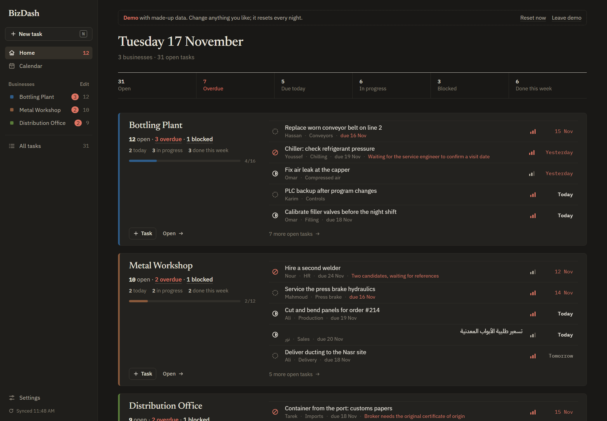
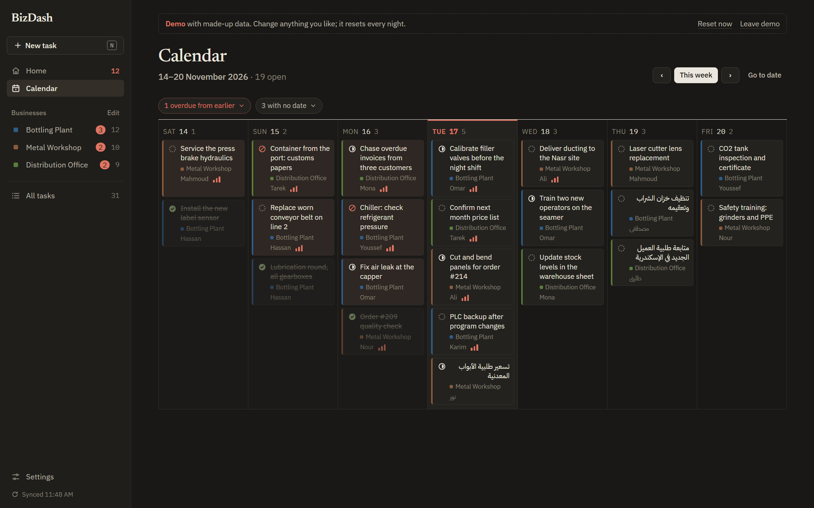
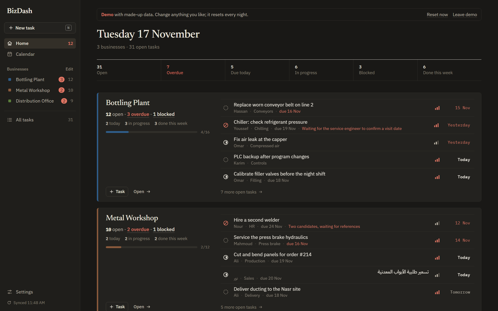

# BizDash

A task dashboard for running several businesses from one place. I built it to manage day-to-day work across my family's businesses, on my phone and laptop at the same time. Anyone can create a free personal account, or try the demo without one.

**Live demo:** https://bizdash.kaream10adel.workers.dev/?demo
(opens the app with made-up sample data, no account needed. Or go to the sign-in page and pick **See demo**, or **Create account** for your own private space. The demo resets every night.)



## What it does

- **Home dashboard:** headline numbers across every business (open, overdue, due today, in progress, blocked, done this week), then one band per business with its progress and the five tasks that need attention first.
- **Business pages:** each business has its own page with Today, Calendar, Upcoming, All and Done tabs.
- **Weekly calendar:** tasks on their planned day; drag a card to another day to re-plan it. Trays above the week hold overdue and undated tasks, ready to drag in.
- **Fast editing:** change status, priority or date straight from any list, select many tasks to edit or delete at once, undo after deleting or finishing.
- **Businesses are data, not code:** add, rename, recolour, reorder and archive them in Settings.
- **Arabic and English** task text side by side (direction is detected per line).
- **Light and dark** themes, and a phone layout with a bottom tab bar.

| Calendar | Business page |
| --- | --- |
|  |  |

## How it's built

```
Browser (React)  ──HTTPS──▶  Cloudflare Worker  ──▶  Cloudflare D1 (SQLite)
   client/                    worker/src/index.js      worker/migrations/
```

- **Frontend:** React 18 + Vite, no UI library. Hand-written CSS with design tokens for both themes.
- **API:** a single Cloudflare Worker (plain JavaScript, no framework). It serves the API under `/api/*` and the built frontend for everything else.
- **Database:** Cloudflare D1 (SQLite), with migrations in `worker/migrations`.
- **Accounts:** open sign-up; passwords hashed with PBKDF2-SHA256 and a random salt; signed JWT sessions (HMAC-SHA256 via Web Crypto); sign-in and sign-up rate-limited per IP.

### Keeping data correct when several devices edit at once

This was the main problem to solve: the same tasks are edited from a phone and a laptop, sometimes minutes apart.

- **Optimistic concurrency.** Every task and business has a `version`. A save carries the version it was based on; if another device saved first, the API answers `409` with the current copy, and the app asks whether to load it or save over it.
- **Only changed fields are sent.** Saving over someone else's edit never wipes fields you didn't touch.
- **The database enforces the rules itself.** `CHECK` constraints and foreign keys reject bad statuses, impossible dates (`2026-02-31`) or unknown businesses, whatever client sends them. Rules SQLite can't add with `ALTER TABLE` are triggers instead.
- **Nothing is lost.** Deletes are soft (`deleted_at`) and can be undone, and every change is written to an `activity_log` in the same transaction, which feeds each task's history.
- **Stays in step:** the app refreshes every 30 seconds while open and whenever the tab comes back into focus.

### Personal accounts

- Every business and task has an owner. After the session is checked, the Worker puts the user's id on the request and every query filters by it, so guessing another user's task or business id gets a 404.
- The database backs this up: triggers refuse a task whose owner differs from its business's owner, and a business can't change hands.
- Users can change their password or delete their account (which removes all their data) from Settings.
- An automated test signs up two users and tries every cross-account read and write (edit, delete, restore, history, export, reorder, adding a task to someone else's business); all are refused.

### Real data and a public demo on the same link

The sign-in page has three tabs: **Sign in**, **Create account** and **See demo**.

- The Worker is bound to two databases: `DB` (accounts and their data) and `DEMO_DB` (sample data).
- **See demo** issues a signed token with `demo: true`. For every request made with that token, the Worker swaps `DEMO_DB` in place of `DB` before any handler runs, so a demo session has no path to the real data. Editing the token breaks its signature and it is rejected.
- `worker/src/demo.js` loads made-up sample data, with dates relative to today so there is always something overdue, due today and coming up.
- A Cron Trigger resets the demo every night, and visitors can reset it themselves.

## Run it locally

Needs Node 20+.

```bash
npm run install:all
npm run db:migrate:local    # creates both local databases
```

Create `.dev.vars` with a signing secret for local sessions:

```
JWT_SECRET=any-long-random-string
```

```bash
npm run dev     # API + local database on :8787, frontend on :5173
```

## Deploy

1. `npx wrangler d1 create bizdash` and `npx wrangler d1 create bizdash-demo`, and put both ids in `wrangler.toml`.
2. `npm run db:migrate`
3. Set the secret `JWT_SECRET`: `npx wrangler secret put JWT_SECRET`. Then open the site and create an account.
4. `npm run deploy`

## Project layout

```
client/              React app (Vite)
  src/components/    views: Home, Business, Calendar, All tasks, Settings, task panel
worker/
  src/index.js       API, validation, accounts and sessions
  src/demo.js        sample data for the demo
  migrations/        database schema
wrangler.toml        Worker, both databases, nightly demo reset
```
